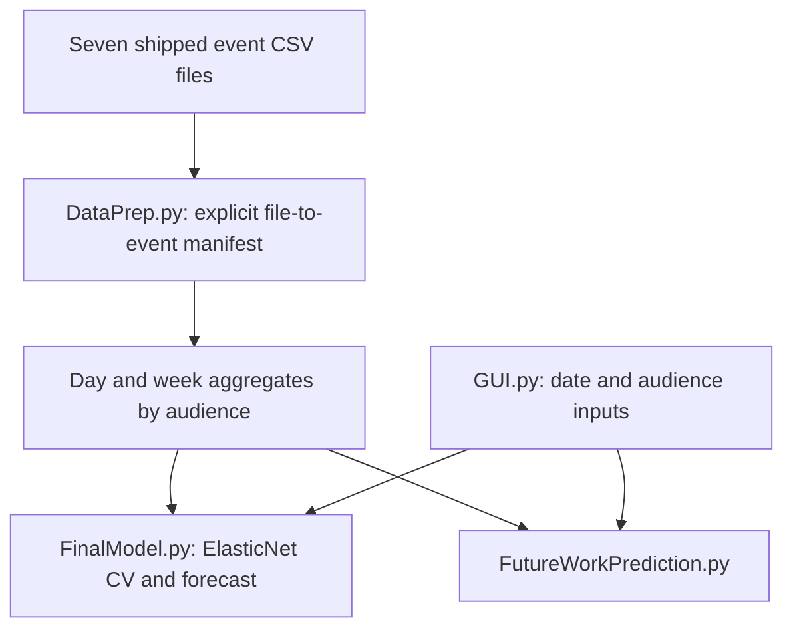

# Event booking prediction coursework: architecture and maintenance

Reviewed source: `d36000cf90d7e2ae260cbef94d65ad99eaf4799d`. Maintenance date: 11 November 2026. This document describes inspected code, the bounded fixes in this change and future work separately. It does not establish production deployment or measured scale. Original coursework/learning material and prior authorship remain identifiable; this maintenance was AI-assisted.

## Implemented architecture



| Component | Source | Responsibility |
| --- | --- | --- |
| Preprocessing | Prediction Model and GUI/DataPrep.py | Named datasets are resolved beside the module, paired with fixed event dates and grouped by audience. |
| Model | Prediction Model and GUI/FinalModel.py | ElasticNet cross-validation, booking prediction and inferred advertisement comparison. |
| View | Prediction Model and GUI/GUI.py | Tkinter date/audience inputs and result presentation. |
| Exploration | Classification Models, Data Imputation, Regression Models, Time Series Models | Academic experiments remain separately identifiable. |

## Engineering decisions in this change

The original group documentation and academic model approach are retained. The maintained GUI data preparation no longer depends on a Windows backslash glob or the caller working directory. Explicit file/date mapping removes filesystem ordering as an implicit data contract. Date columns retain datetime dtype on current Pandas; constant weeks have finite zero z-scores.

## Reproduce checks and run

Run from the repository root with Python 3.12 or Node 22 as appropriate. Use a virtual environment before installing Python dependencies.

```bash
python -m pip install -r requirements-maintenance.txt
```

```bash
python -m unittest discover -s tests -v
python "Prediction Model and GUI/GUI.py"
```

The data-preparation regression imports from an unrelated working directory, loads all seven shipped datasets, checks explicit ordering and datetime dtypes, and rejects post-event rows from prepared data.

## Current boundaries

The architecture represents coursework. Random train/test splitting and advertisement flags inferred from booking outliers do not establish causal advertising effects or future-event generalization. GUI/model training runs locally; model-selection, calibration and a full GUI flow have not been validated by the data-loading regression. Do not reuse training data with personal details in a public service.

## Scaling path and acceptance evidence

Cache prepared data and model artifacts by dataset hash and parameters instead of retraining for every GUI request. Evaluate using event-level and chronological holdouts before exposing predictions. Introduce a documented data schema, explicit missing-date policy and job queue only if measured training latency requires them. Record MAE by event/audience and compare a naive booking baseline.

## Maintenance and recovery

Keep data and credentials out of source changes. Reproduce a failure with synthetic inputs before modifying a transformation or user action. Run the focused CI checks, review changes to input/output contracts and retain the prior commit for rollback. Back up local CSV/database inputs outside the working tree before manual runs. Revert the maintenance commit to roll back code; preserve data separately because reverting code does not reverse data mutations. Record environment versions, input schema, failure steps and expected/actual behavior in future bug reports.
