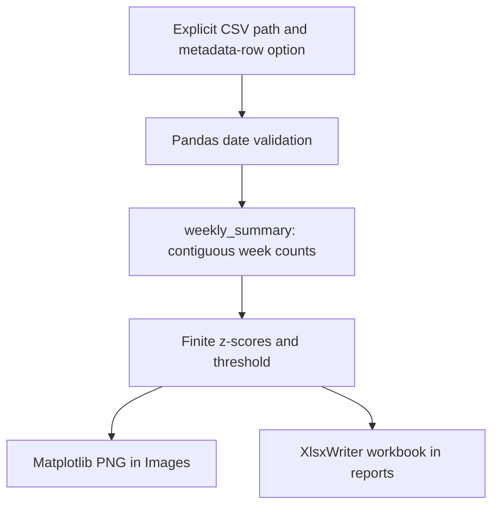

# Booking activity analytics: architecture and maintenance

Reviewed source: `6c276b28fd829ef91ab308e4dfc2af365c692276`. Maintenance date: 11 November 2026. This document describes inspected code, the bounded fixes in this change and future work separately. It does not establish production deployment or measured scale. Original coursework/learning material and prior authorship remain identifiable; this maintenance was AI-assisted.

## Implemented architecture



| Component | Source | Responsibility |
| --- | --- | --- |
| Current entry point | FinalAnalytics.py | CLI selects a CSV; importing the module no longer runs a personal path. |
| Computation | weekly_summary | Validates date column and empty data; includes zero-booking weeks and handles constant counts. |
| Outputs | Images and reports folders beside selected CSV | PNG and Excel report contain the same weekly summary. |
| Earlier iterations | Analytics1.py through Analytics9.py | Historical development stages; the maintained interface is FinalAnalytics.py. |

## Engineering decisions in this change

The historical March 2024 provenance in README is retained. Maintenance dated 11 November 2026 extracts a testable summary, removes import-time file access and assigns zero z-scores when every week has the same count. Standard CSV headers are the default; --skiprows 1 supports older files with a metadata line.

## Reproduce checks and run

Run from the repository root with Python 3.12 or Node 22 as appropriate. Use a virtual environment before installing Python dependencies.

```bash
python -m pip install -r requirements.txt
```

```bash
python -m unittest discover -s tests -v
python FinalAnalytics.py /path/to/bookings.csv
# Historical metadata row: add --skiprows 1
```

4 summary regressions cover constant counts, missing weeks, invalid inputs and input immutability; a headless report smoke verifies PNG and XLSX output.

## Current boundaries

Each input is loaded into memory; plotting may require a display unless MPLBACKEND=Agg is set. Z-score flags are descriptive outliers, not causal evidence or a validated forecast. Earlier iteration scripts still contain historical local paths and should not be used as the maintained entry point.

## Scaling path and acceptance evidence

For larger CSVs, aggregate date/week counts in read_csv chunks before calculating the summary; test chunked and in-memory parity. Bound the date range to avoid huge sparse calendars, run one output job per file with unique output names, and reuse workbook formats. Measure peak RSS, rows processed and report latency before claiming capacity.

## Maintenance and recovery

Keep data and credentials out of source changes. Reproduce a failure with synthetic inputs before modifying a transformation or user action. Run the focused CI checks, review changes to input/output contracts and retain the prior commit for rollback. Back up local CSV/database inputs outside the working tree before manual runs. Revert the maintenance commit to roll back code; preserve data separately because reverting code does not reverse data mutations. Record environment versions, input schema, failure steps and expected/actual behavior in future bug reports.
